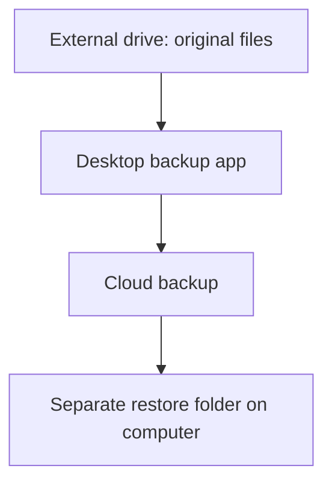
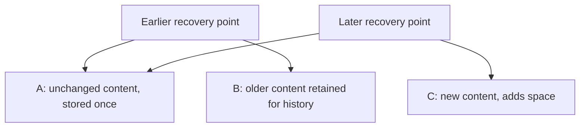

# Visuals in CMS blog content

CMS articles support a deliberately restricted Markdown/MDX-like syntax, not executable MDX. Do not add imports, JavaScript expressions, spread attributes, or event handlers. Use literal attribute values.

## Choose the format by purpose

- **Illustrations:** original or appropriately licensed images. AI-generated art may suit a cover or a simple visual metaphor, without dense labels or numbers. Never fabricate a product screenshot.
- **Processes and relationships:** existing fenced `mermaid` diagrams. Keep labels brief; explain qualifications in the article's ordinary text.
- **Parts of a numerical total:** `StackedBar` with `BarSegment` children. It renders server-side using the site's typography and theme, without a chart library, hydration, or hover-only values.

Keep essential facts in accessible text, not embedded in a raster graphic. Check diagrams on a narrow screen. Do not replace a diagram with a generated picture just to match a cover's style.

## Flow: source, backup and separate restore target

Paste this fenced block into the CMS content field. No component imports are required.

````md


The external drive contains the originals. Back up from it to the cloud; restore test copies into a separate folder, never over the originals.
````

The same approach works for a small pilot: select a harmless sample, finish a backup, restore to a new empty folder, then open the restored files. A successful sample test is not proof that every file will restore.

## Relationships: unchanged content and retained history

````md


Stored content is A + B + C. B remains necessary while retained history references it. This is conceptual: block sizes and storage savings are not measured.
````

Use shared targets to show shared content instead of hand-drawing crossing connectors or implying measured savings.

## Capacity breakdown: native stacked bar

```mdx
<StackedBar title="Storage planning: hypothetical example" unit="GB">
  <BarSegment label="Selected files" value="180" />
  <BarSegment label="New unique data" value="20" />
  <BarSegment label="Retained history" value="45" />
  <BarSegment label="Overhead / cleanup" value="5" />
  <BarSegment label="Free headroom" value="62.5" />
</StackedBar>

Projected use is 250 GB. To leave 20% of total capacity free, divide by 0.80: 250 / 0.80 = 312.5 GB total capacity, with 62.5 GB free. Adding 20% to 250 GB would not leave 20% of the result free.

These are illustrative assumptions, not a required tier or universal margin. Verify the provider's units and quota definition.
```

Place `StackedBar` as a block separated from prose by blank lines, with only direct `BarSegment` children. Segment values are numbers in the stated unit, not precomputed percentages. Use 1–8 segments with positive decimal values from `0.000001` to `1000000000000`, no thousands separators or exponent notation, and at most six decimal places. The sum must not exceed `1000000000000`. Titles are limited to 160 characters, units to 24 and segment labels to 120. Invalid content produces an authoring error rather than silently dropping a chart.

Include headroom as a segment if it is part of the total capacity you are depicting. The chart derives each segment's share from their sum. It does not calculate a forecast, deduplication savings, or a recommended plan size.

The data table remains visible, including when JavaScript is disabled, so readers do not need color discrimination or a tooltip to obtain values. Titles, units and labels are plain text. Chart colors come from the site theme, not arbitrary CMS-supplied styles.

## Rollout

Merge and deploy the component support before inserting `StackedBar` into CMS records: the currently deployed parser will reject unknown components. Fenced Mermaid already exists. This change itself does not edit or publish any CMS record.
